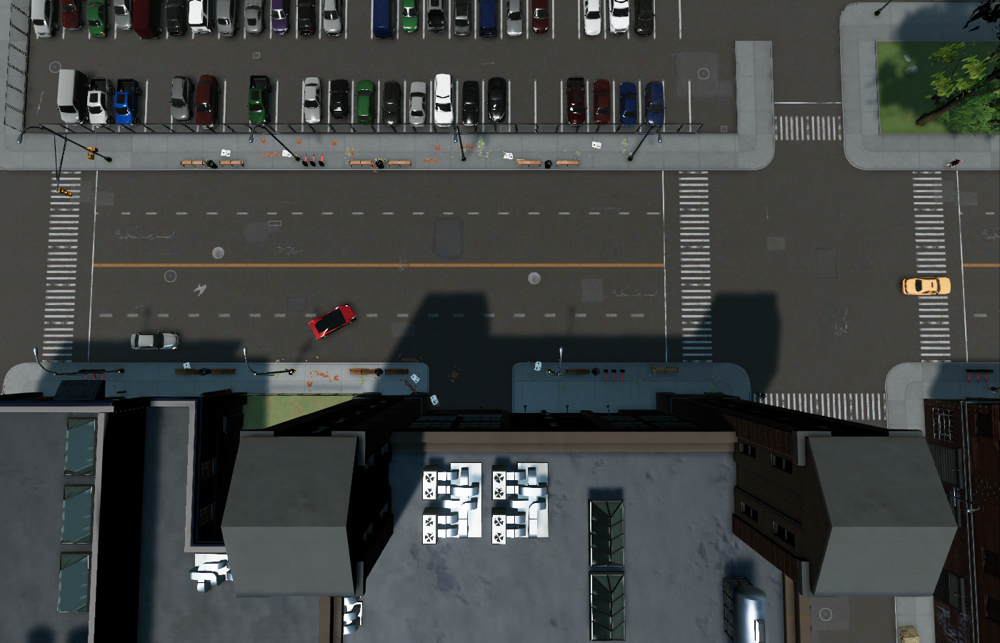
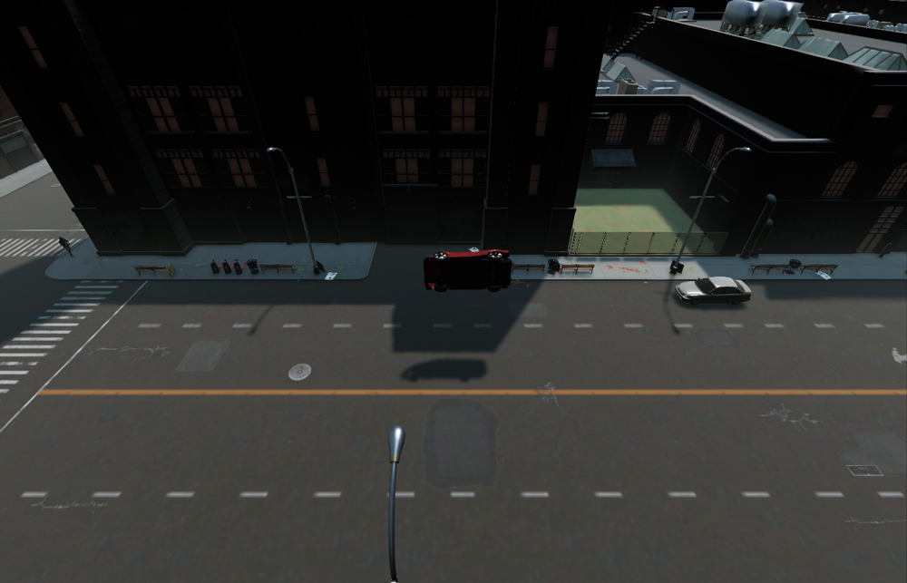
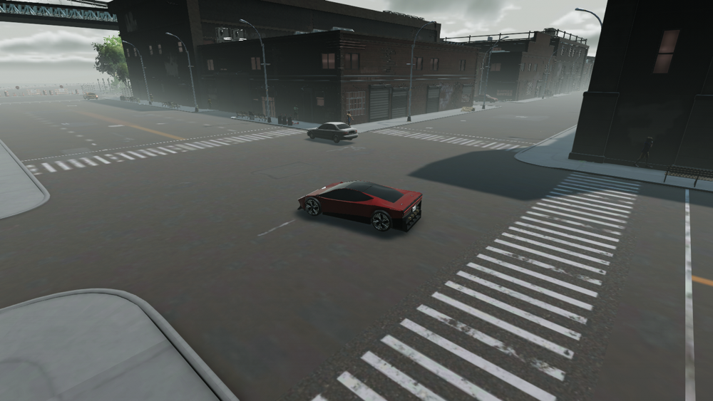

# PC rig proof (agent1): 0.0.3 motor timing (0.0.2 vs 0.0.3) and left roll

**Verdict: PASS for this focused measurement session. Timing conclusion: SAME.** BEFORE motor median **1.31 s**, AFTER **1.29 s** (AFTER 0.02 s faster, about 1.5%). The old 1.55–1.65 s CHECKS range is stale for this rig/game build and protocol. Propose **1.25–1.35 s**, centred at 1.30 s with a ±0.05 s margin covering both observed spreads. This proposes a rig-specific range; no CHECKS or production change was made. Clean left roll PASS. Optional stopped-J departure INCOMPLETE. Native QA passed on both builds. Original rig restored and lease released.

PR #1 candidate `0e6d82332cc122235fca10c1ede90745939114b7`, branch `codex/rdstr-0.0.3`, version 0.0.3. PR head independently rechecked unchanged and draft. BEFORE master build `2250540`, version 0.0.2. Windows native game build **3682** on existing isolated `C:\BigAmbitions-AgentTests`. Requested role/model: rig_test, Codex Sol/high; provider-returned model identity is not available to assert. No production code or repository test edits, merge, source-branch push, PR-body edit, release/Workshop upload, Steam/Windows/graphics settings change, or normal-game launch/control.

## Matched timing method and all accepted runs

Same disposable copy of `FT RDSTR Rig 20261031 Before`, same car and flat boulevard lane; both builds freshly loaded the fixture with damage 0. Same dry daylight conditions (day 1, roughly 10:10–11:22). Motors were confirmed through native `Launch mode: motors.` and `Launch started (motors...)` lines; N then selected nitrogen. Each run used the same test observer: native teleport fixture near x=-1490,z=-964, heading 90°, **five seconds of handbrake-only settling**, then fixture rest/heading initialization once, immediately before applying **Throttle=1.00, Steering=0.00**. Initial measured body speed was **0.000 m/s in all 16 accepted runs**. Input stayed at full throttle for 1.7 real seconds, then handbrake stopped the car. Body velocity/angular velocity were zeroed only for the allowed stationary fixture initialization, before input; no pose, velocity, force, mass, wheel/engine parameters, clock speed, fixed timestep or frame-pacing setting was assigned during the measurement sequence. The observer restores native input ownership after each sequence. The input CSV records injected/held key requests queued through Input System and sampled control values; native mode and stunt logs establish that the N/Backslash edges were accepted.

Actual start positions are retained in runs.csv: the handbrake settle introduces small positional jitter; accepted starts form the same small cluster near x=-1489.44,z=-964.82 in both builds. Heading is 90°. Helper collision-enter **and collision-stay** callbacks and native mod contact logs were checked; all accepted sequences have no scenery/vehicle contact. Road surface is `BridgeConnectionGroundPlane`.

The source of truth below is the mod's own interpolated 0–60 log. Independent timing linearly interpolates body-speed magnitude through 26.8224 m/s from the initial full-input sample; it is an observer cross-check and has a different frame/fixed-step origin. All accepted samples show fixed timestep **0.020 s**, time scale **1.0**, zero steering and full input. No screenshot was taken during timing. Observed FPS is in the table; per-run frame-delta extrema are in runs.csv. Existing target frame rate 90 and vSyncCount 0 were observed, not changed.

| Build | Mode | Run | Mod s | Independent body s | FPS | Game clock |
| --- | --- | ---: | ---: | ---: | ---: | --- |
| 0.0.2 BEFORE | motors | 1 | 1.31 | 1.278 | 87.3 | 10:10 |
| 0.0.2 BEFORE | motors | 2 | 1.31 | 1.290 | 87.3 | 10:20 |
| 0.0.2 BEFORE | motors | 3 | 1.30 | 1.264 | 89.6 | 10:30 |
| 0.0.2 BEFORE | motors | 4 | 1.30 | 1.273 | 85.9 | 10:40 |
| 0.0.2 BEFORE | motors | 5 | 1.31 | 1.284 | 88.7 | 10:50 |
| 0.0.2 BEFORE | nitrogen | 1 | 0.60 | 0.588 | 87.9 | 11:01 |
| 0.0.2 BEFORE | nitrogen | 2 | 0.60 | 0.593 | 88.8 | 11:11 |
| 0.0.2 BEFORE | nitrogen | 3 | 0.63 | 0.614 | 88.2 | 11:21 |
| 0.0.3 AFTER | motors | 1 | 1.29 | 1.280 | 89.7 | 10:10 |
| 0.0.3 AFTER | motors | 2 | 1.29 | 1.275 | 89.9 | 10:21 |
| 0.0.3 AFTER | motors | 3 | 1.30 | 1.279 | 89.8 | 10:31 |
| 0.0.3 AFTER | motors | 4 | 1.29 | 1.279 | 89.5 | 10:40 |
| 0.0.3 AFTER | motors | 5 | 1.30 | 1.282 | 89.7 | 10:50 |
| 0.0.3 AFTER | nitrogen | 1 | 0.60 | 0.585 | 89.7 | 11:01 |
| 0.0.3 AFTER | nitrogen | 2 | 0.63 | 0.614 | 87.4 | 11:11 |
| 0.0.3 AFTER | nitrogen | 3 | 0.60 | 0.590 | 88.3 | 11:22 |

| Build / mode | n | Median s | Min s | Max s |
| --- | ---: | ---: | ---: | ---: |
| BEFORE motors | 5 | 1.31 | 1.30 | 1.31 |
| AFTER motors | 5 | 1.29 | 1.29 | 1.30 |
| BEFORE nitrogen | 3 | 0.60 | 0.60 | 0.63 |
| AFTER nitrogen | 3 | 0.60 | 0.60 | 0.63 |

All six nitrogen controls are inside 0.57–0.63 s. The motor comparison meets SAME: BEFORE is also about 1.3 s and its median differs from AFTER by only 0.02 s, well within 0.1 s. This evidence does not attribute the old timing discrepancy to a 0.0.3 regression, and does not replace the broader 31 October appearance/camera acceptance.

## Setup trials retained, with reasons

The observer/harness needed correction before the final protocol. The preliminary native-key route ended with S, and a braking setup at rest selected reverse, allowing the car to drift away from the fixed start before the next command. A later Space attempt toggled pause. Those are recorded input/setup glitches, not alternative valid motor measurements. Early direct-input trials also failed the stop/contact gates. No run was removed because its number was inconvenient. **Every completed timing request is retained below and in runs.csv**; raw samples and input CSV retain the defects. Only the two identically corrected, five-run protocols above enter the comparison medians.

The uploaded 0.0.2 reference archive was used only for a cheap three-run cross-check when the preliminary native-key timings looked surprising. Its 0.87/0.86/0.86 s results share the preliminary setup flaw, so they are retained here as discarded reference trials and are not substituted for the master BEFORE or used to set the proposed range. The separate 0.85-throttle calibration ended at 59 mph after 1.52 s and is also retained, not represented as full throttle.

| Setup trial | Mode | Logged s | Discard reason |
| --- | --- | ---: | --- |
| after-final-native-motors-1 | motors | 0.87 | input glitch: preliminary brake-at-rest route selected reverse and allowed start-position drift |
| after-final-native-motors-2 | motors | 0.86 | input glitch: preliminary brake-at-rest route selected reverse and allowed start-position drift |
| after-final-native-motors-3 | motors | 0.87 | input glitch: preliminary brake-at-rest route selected reverse and allowed start-position drift |
| after-final-native-motors-4 | motors | 0.86 | input glitch: preliminary brake-at-rest route selected reverse and allowed start-position drift |
| after-final-native-motors-5 | motors | 0.86 | input glitch: preliminary brake-at-rest route selected reverse and allowed start-position drift |
| after-final-native-nitrogen-1 | nitrogen | 0.6 | input glitch: preliminary brake-at-rest route selected reverse and allowed start-position drift |
| after-final-native-nitrogen-2 | nitrogen | 0.6 | input glitch: preliminary brake-at-rest route selected reverse and allowed start-position drift |
| after-final-native-nitrogen-3 | nitrogen | 0.6 | input glitch: preliminary brake-at-rest route selected reverse and allowed start-position drift |
| after-steady-native-motors-1 | motors | 1.21 | input glitch: Space toggled pause; inconsistent time scale / setup sequence |
| after-steady-native-motors-2 | motors | no completed line | no completed launch log; input glitch: Space toggled pause; inconsistent time scale / setup sequence |
| after-steady-native-motors-3 | motors | 1.22 | input glitch: Space toggled pause; inconsistent time scale / setup sequence |
| after-steady-native-motors-4 | motors | no completed line | no completed launch log; input glitch: Space toggled pause; inconsistent time scale / setup sequence |
| after-steady-native-motors-5 | motors | 1.21 | input glitch: Space toggled pause; inconsistent time scale / setup sequence |
| before-final-native-motors-1 | motors | 1.23 | input glitch: preliminary brake-at-rest route selected reverse and allowed start-position drift |
| before-final-native-motors-2 | motors | 0.86 | input glitch: preliminary brake-at-rest route selected reverse and allowed start-position drift |
| before-final-native-motors-3 | motors | 0.86 | input glitch: preliminary brake-at-rest route selected reverse and allowed start-position drift |
| before-final-native-motors-4 | motors | 0.86 | input glitch: preliminary brake-at-rest route selected reverse and allowed start-position drift |
| before-final-native-motors-5 | motors | 0.86 | input glitch: preliminary brake-at-rest route selected reverse and allowed start-position drift |
| before-final-native-nitrogen-1 | nitrogen | 0.6 | input glitch: preliminary brake-at-rest route selected reverse and allowed start-position drift |
| before-final-native-nitrogen-2 | nitrogen | 0.63 | input glitch: preliminary brake-at-rest route selected reverse and allowed start-position drift |
| before-final-native-nitrogen-3 | nitrogen | 0.6 | input glitch: preliminary brake-at-rest route selected reverse and allowed start-position drift |
| before-motors-0 | motors | 0.99 | not stopped; input glitch: preliminary rest/pose/input setup; not the corrected matched protocol |
| before-motors-1 | motors | no completed line | no completed launch log; not stopped; contact; input glitch: preliminary rest/pose/input setup; not the corrected matched protocol |
| before-native-motors-1 | motors | 0.87 | input glitch: preliminary brake-at-rest route selected reverse and allowed start-position drift |
| before-native-motors-2 | motors | 1.26 | input glitch: preliminary brake-at-rest route selected reverse and allowed start-position drift |
| before-native-motors-3 | motors | 1.24 | input glitch: preliminary brake-at-rest route selected reverse and allowed start-position drift |
| before-native-motors-4 | motors | no completed line | no completed launch log; input glitch: preliminary brake-at-rest route selected reverse and allowed start-position drift |
| before-native-motors-5 | motors | 1.27 | input glitch: preliminary brake-at-rest route selected reverse and allowed start-position drift |
| before-native-motors-6 | motors | 1.23 | input glitch: preliminary brake-at-rest route selected reverse and allowed start-position drift |
| before-native-nitrogen-1 | nitrogen | 0.64 | contact; input glitch: preliminary brake-at-rest route selected reverse and allowed start-position drift |
| before-native-nitrogen-2 | nitrogen | 0.63 | input glitch: preliminary brake-at-rest route selected reverse and allowed start-position drift |
| before-native-nitrogen-3 | nitrogen | 0.59 | contact; input glitch: preliminary brake-at-rest route selected reverse and allowed start-position drift |
| before-native-nitrogen-4 | nitrogen | 0.63 | input glitch: preliminary brake-at-rest route selected reverse and allowed start-position drift |
| before-native-nitrogen-5 | nitrogen | 0.6 | contact; input glitch: preliminary brake-at-rest route selected reverse and allowed start-position drift |
| before-native-nitrogen-6 | nitrogen | 0.6 | input glitch: preliminary brake-at-rest route selected reverse and allowed start-position drift |
| reference-native-motors-1 | motors | 0.87 | input glitch: preliminary brake-at-rest route selected reverse and allowed start-position drift |
| reference-native-motors-2 | motors | 0.86 | input glitch: preliminary brake-at-rest route selected reverse and allowed start-position drift |
| reference-native-motors-3 | motors | 0.86 | input glitch: preliminary brake-at-rest route selected reverse and allowed start-position drift |
| before-native-trial | motors | 0.99 | input glitch: preliminary native-key/rest setup; start spot differs from matched protocol |
| before-legacy-085 | motors | no completed line | input glitch: retained transmission/input history; launch ended at 59 mph after 1.52 s |

## Clean left barrel roll — AFTER only

| Attempt | Input and measured takeoff | Peak / roll / touchdown / tilt / air time | Contacts | Result |
| --- | --- | --- | --- | --- |
| 1 | throttle 0.85 to >10 m/s, steer -0.30, Backslash held 0.16 s; native left 22 mph | 6.3 m / 360° / 2.6 m/s / 2° / 2.62 s | none recorded | INCOMPLETE proof: car moved after the overhead capture; actual initial x=-1538.28, z=-977.92 did not match the photographed spot. Mid-air camera missed the car. Retained, not accepted. |
| 2 | same moving-input sequence; native left 23 mph, helper key sample recorded | 6.3 m / 360° / 2.6 m/s / 2° / 2.62 s | zero collision-enter/stay events through drive, takeoff, landing and stop; no native scenery/vehicle contact line | PASS. Actual initial x=-1549.44, z=-975.83 matches paused overhead within 0.01 m. Overhead, mid-air and landing PNGs inspected. |

The accepted corridor was inspected in the observer overhead before unpausing; heading was initialized to 90° as fixture setup before driving. The corridor ahead was free of scenery and vehicles; distant traffic remained on other portions of the boulevard. The mid-air image shows the actual rolling car. Only the running game's observer camera rendered these PNGs; published images are resized proportionally to width <=1000, with original/published SHA-256 and the resize recorded in screenshots-manifest.json. No generated or composited imagery. This is locked-session observer proof, not subjective native-camera or handling acceptance. Free hover/pointer work remains SKIPPED-LOCKED; no Windows lock/sleep/display setting was changed.





```text
[Mod:Roadster] Barrel roll to the left at 23 mph.
[Mod:Roadster] Barrel roll landed: peak 6.3 m, rolled 360 degrees, touchdown 2.6 m/s, 2 degrees off level, 2.62 s in the air.
```

## Optional default J — INCOMPLETE

HART. Self Driving 0.4.1 was copied read-only from Workshop item 3819853552 into agent1 for this short separate test, after timing. Copy hashes verified; source rehash remained unchanged. Default bindings were retained. With pinned destination 51 Third Street and initial body speed 0.000 m/s, J selected the Roadster and entered Self Driving. It cancelled during unparking because there was not enough clear straight road to pull out; no sustained departure and no Roadster roll. One attempt, no extended route investigation. The temporary copy was removed by full profile restoration.

```text
[Mod:DrivenRides] Own car: driving itself (roadster:vehicletype_roadster, wheelbase 2.79 m).
[Mod:DrivenRides] Ride cancelled: unparking: not enough clear straight road to pull out.
[Mod:DrivenRides] Own car: the keys are the player's again (cancelled: unparking: not enough clear straight road to pull out).
```

## Native QA and package identity

Both versions logged their correct loading version, `Vehicle registered: roadster:vehicletype_roadster`, dealer `Active: VehicleContractSettings.SetListOfVehiclesForSale.`, and `Plumes found: 4 rear, 2 down.` No `[Mod:Roadster]` ERROR line in either complete matched-run native log. Native startup excerpts and every accepted launch line are in native-excerpts.log; full-log hashes are in log-audit.json. Existing native NavMesh/null-renderer warnings and setup contact diagnostics are not silently attributed to Roadster errors.

| Archive | SHA-256 (verified before use; CRC/member hashes also checked) |
| --- | --- |
| after-0e6d823-Roadster-0.0.3-preview.zip | `df2621160712a539821d7f80ff31262cfe6aa2f798d1bf26ebfd78ea62bddd04` |
| before-master-2250540-Roadster-0.0.2-preview.zip | `d64d67074a1e4b62d2e52631b7375e5314d0d19f9601ad683d041cbc89154f7e` |
| uploaded-0.0.2-Roadster-0.0.2-preview.zip | `28877bf82f13dab6a63b998efae6d515fc75e0d13a258929193c894aac793057` |

Exactly one Roadster package was installed at a time. The approved existing agent rig's managed game hash remains `055700fd26a7a6430bbb6a9d79379781909fbc518af760453396947887db5063`; this is existing-rig evidence, not a newly provisioned stock-runtime validation. No game DLL, decompiled code, binary mod/helper, save or credential is committed. The observer is test-only and retained outside the repository; source and DLL hashes are in raw-evidence-manifest.json.

## Restoration and lease

- Owner `rdstr-pr1-0.0.3-rig2` acquired the free lease at **2026-11-01T07:04:45.7160761Z**. No takeover or wait was needed. Launches used the compiled lifecycle permit and no-game-process/receipt-hash guards. Two premature lifecycle requests were refused while native quit was still pending; they made no mutation, and the session waited for exit.
- Backed up the entire isolated profile, preferences, installation receipt, run receipt and prior native log before installation. Unrelated agent1 mods were parked and original content retained. Only copies of disposable fixtures were exercised.
- Restoration verified at **2026-11-01T07:32:59.6337661Z**: **4828 profile files** match inventory/SHA-256; **107 installation references** match; preferences and all three root-file hashes match backup. Temporary helpers/Self Driving/test saves are outside the restored active profile.
- Preferences SHA-256 `66fccbcc5f63bc492e36ba7f342d9d2480adb2b87404a650a8607094d207381d`. Restored installation receipt `9785d1de5c7360875b2a2a47f511815660dd98a38d6f64ab4ecff8c20627b949`. Original run receipt and Player-agent.log hashes are in lifecycle.json.
- Released at **2026-11-01T07:35:04.7539800Z UTC**, final lease **unheld, zero pending operations, no Big Ambitions process**. The rig quit natively. Peter's normal game/profile/preferences/ModsLocal were not controlled or modified. Workshop source files rehashed unchanged. No wake/power/graphics change.

The lease controller, restore receipt and final status are summarized without credentials in lifecycle.json. Raw telemetry/native PNGs, backup and exercised profile are retained locally. This PASS closes the requested measurement and clean-left-roll follow-up; optional J departure remains INCOMPLETE.
